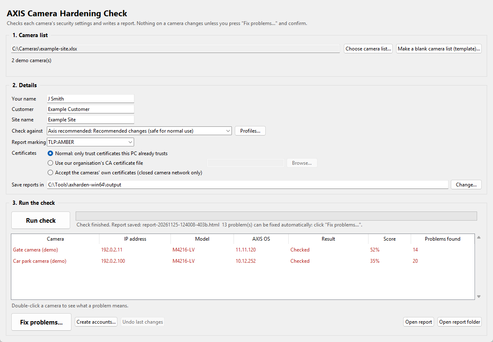
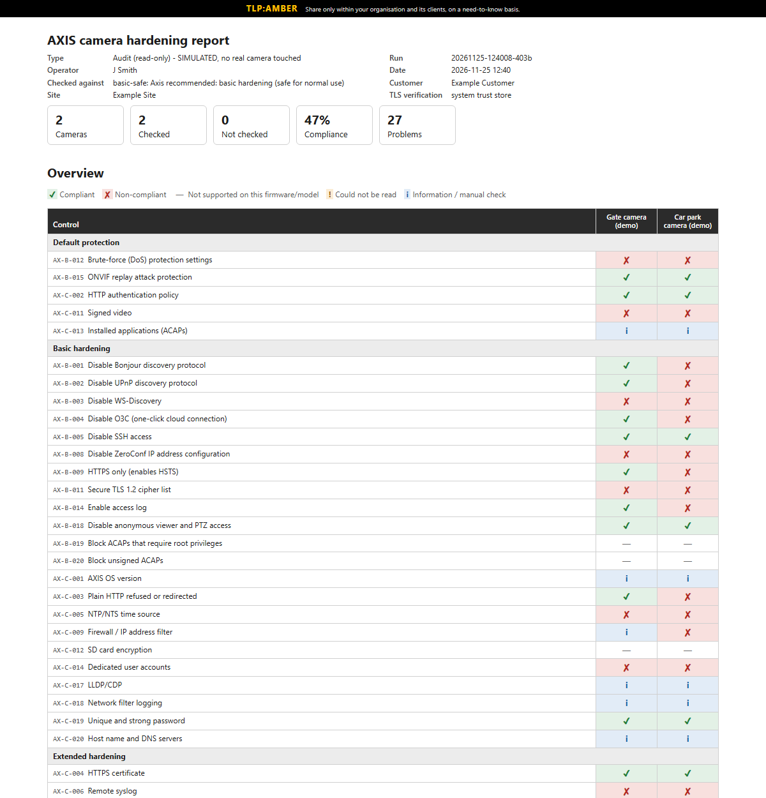
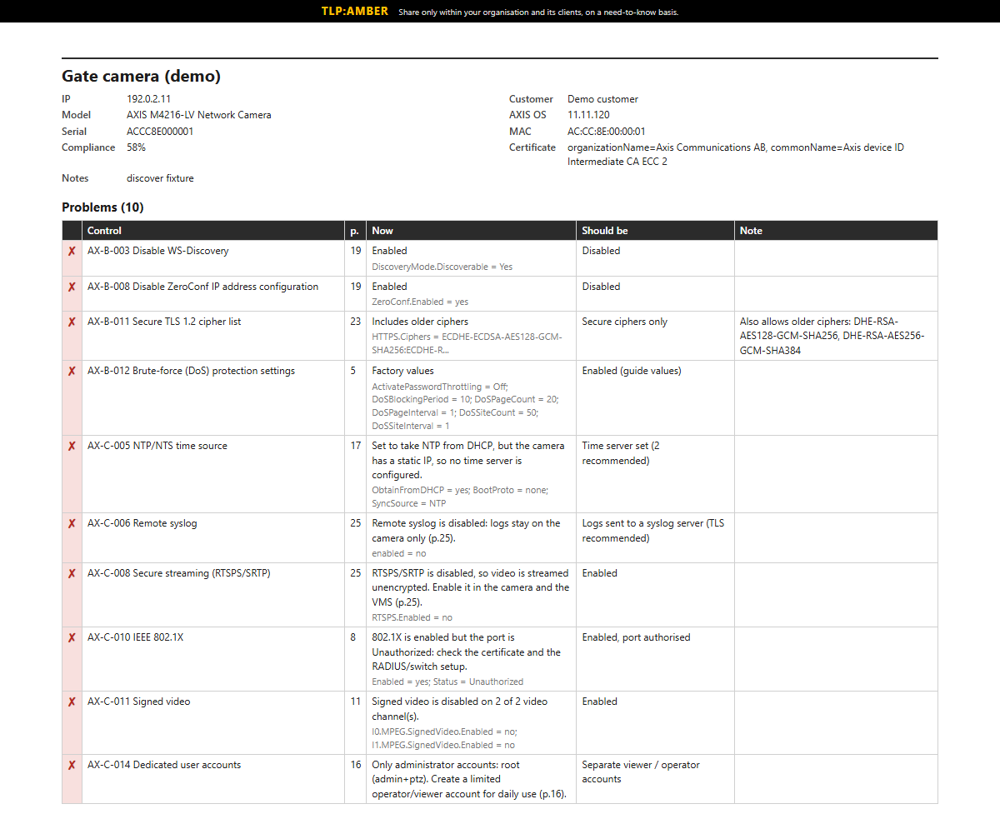
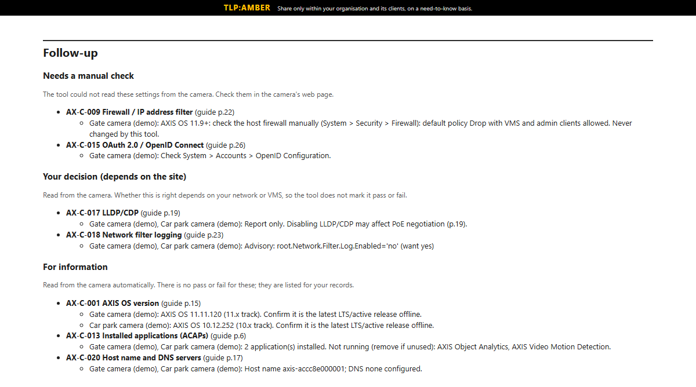
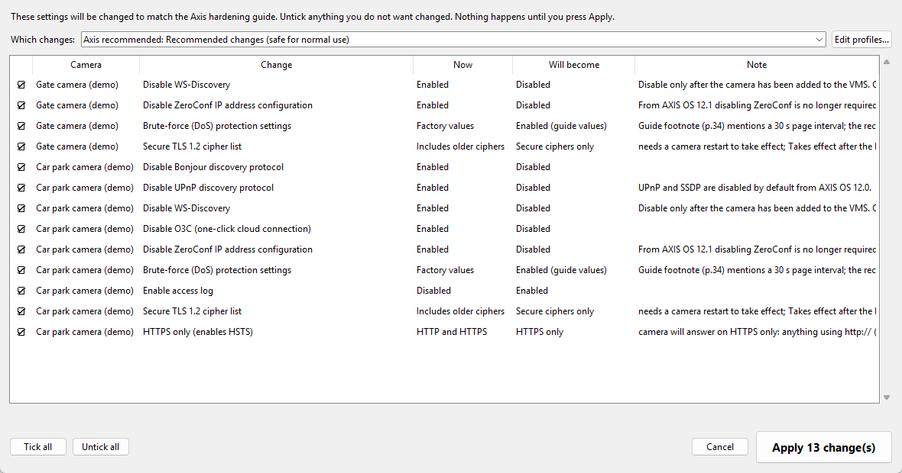
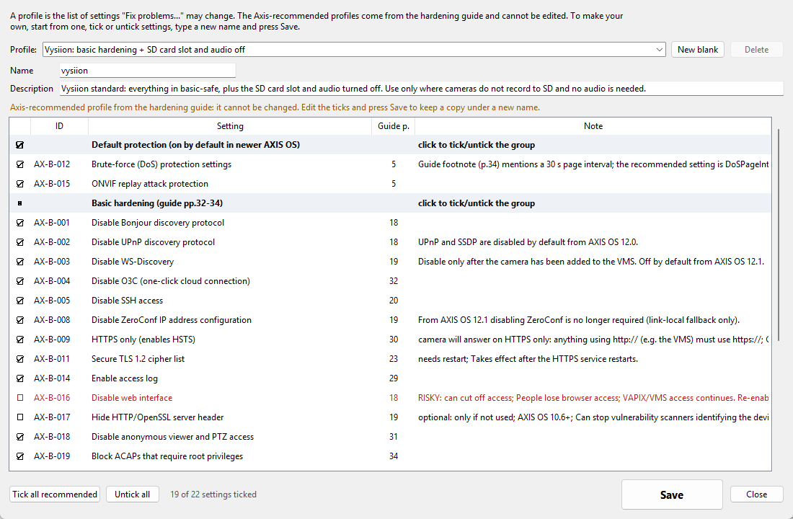
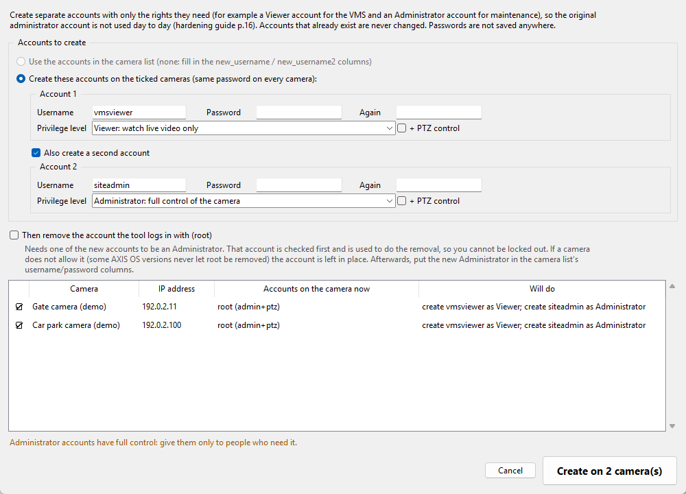

# AXIS Camera Hardening Check (axharden)

A portable, offline tool that checks AXIS cameras (AXIS OS 10.0 and later) against the
**AXIS OS Hardening guide T10177717 (2026-07)**, fixes what you choose, and writes a report you can hand over.

- **Offline.** No installer, no internet, no telemetry. The only network traffic is to the camera IPs in your list.
- **Read-only unless you say otherwise.** A check never changes a camera. Fixing always shows a preview, needs
  your confirmation, reads every change back, logs it, and can be undone.
- **Passwords stay in memory.** They are read from your camera list (or typed in) at the start of each run and
  never written to any file, log or report.
- **Built for non-technical users.** One window, three steps, plain English. A command-line version is included.



*All screenshots use the built-in demo (recorded camera data, no real cameras).*

---

## Contents

1. [Quick start](#1-quick-start)
2. [The report](#2-the-report)
3. [Fixing problems](#3-fixing-problems)
4. [Profiles and baselines](#4-profiles-and-baselines)
5. [Separate user accounts](#5-separate-user-accounts)
6. [The camera list](#6-the-camera-list)
7. [Command line](#7-command-line)
8. [What the tool does to cameras](#8-what-the-tool-does-to-cameras)
9. [Files it creates](#9-files-it-creates)
10. [Development, testing and review](#10-development-testing-and-review)

---

## 1. Quick start

1. **Copy** the `axharden-win64` folder to the PC (a USB stick is fine; nothing is installed) and double-click
   **`AXIS Hardening Check GUI.exe`**.
2. **Step 1 – Camera list.** Click *Choose camera list...* and pick your Excel or CSV file. No list yet? Click
   *Make a blank camera list (template)...*, fill in one row per camera (`ip` and `username` are enough) and
   choose it. Leave passwords blank and the program asks for them, once per username.
3. **Step 2 – Details.**
   - **Your name**, **Customer** and **Site name** go on the report.
   - **Check against** is the baseline: *Everything* (every control in the guide), an Axis-recommended profile,
     Vysiion, or a profile of your own. Only controls in the baseline are scored and listed as problems.
   - **Report marking**: TLP:CLEAR / GREEN / AMBER / AMBER+STRICT / RED, or your own text.
   - **Certificates**: if cameras come back as *Certificate problem*, choose *Accept the cameras' own
     certificates* (closed camera networks only) and run again.
4. **Step 3 – Run check**, then **Open report**. Double-click a camera to see what each problem means.
5. **Optional:** **Fix problems...**, **Create accounts...**, and **Undo last changes** if you need to put
   things back.

Not sure yet? **Tools > Try a demo** runs everything on recorded data with no cameras.

---

## 2. The report

One self-contained HTML file per run. It opens in any browser, prints to A4 (print to PDF if you need a PDF),
loads nothing from the internet, and contains no passwords. A CSV and a JSON copy of the results are saved next to it.

**Summary and overview** — who ran it, for which customer and site, the baseline, compliance, and a grid of every
control for every camera:



**Each camera** — device details, then only its problems, in plain words: what it is **now**, what it **should
be**, and the camera's own setting underneath for evidence. Everything else is one click away:



**Follow-up** — items that are not simple pass/fail, sorted by what you need to do with them:



| Symbol | Meaning |
|---|---|
| ✔ | Compliant |
| ✘ | Non-compliant |
| — | Not supported on this firmware/model, not applicable, or not part of the chosen baseline |
| i | For information, your decision, or a manual check (see *Follow-up*) |
| ! | Could not be read |

Compliance % counts only ✔ and ✘.

---

## 3. Fixing problems

Click **Fix problems...** after a check. Every change is listed per camera with a tick box, what it is now and what
it will become. Nothing happens until you press **Apply**.



- **Pick the profile** at the top (*Which changes*). It starts on the baseline you checked against.
- **Untick** anything you do not want changed.
- **Risky changes** (turning the web interface off) start unticked, are shown in red and need an extra confirmation.
- **HTTPS only** is ticked like the rest: the tool first proves HTTPS works, switches, then reconnects over HTTPS.
  Anything still using `http://` (for example the VMS) must be changed to `https://`.
- **Back to factory default** rows (orange) appear for settings the chosen profile leaves out. A profile is the
  complete wanted state, so applying basic-safe after Vysiion turns the SD card slot back on. Untick them to leave
  those settings alone.
- **Camera settings from your list** (host name, DNS, NTP, time zone, syslog, firewall) appear as *Set ...* rows whatever the profile.
- **Firewall** (AXIS OS 11.9+, `allow` column) is risky, so it starts unticked. The tool switches the firewall on with an accept-all set, then sets the real rules with the camera's own 60-second auto-revert, reconnects, and only confirms if the camera still answers. If it cannot reach the camera, it does not confirm and the camera restores access by itself.
- **Restarts:** the TLS cipher change only takes effect after a restart. When it is needed the program offers to
  restart exactly those cameras and waits until each answers again (also *Tools > Restart cameras...*).

Every change is read back from the camera; a mismatch is reported as failed. **Undo last changes** puts the old
values back.

---

## 4. Profiles and baselines

A profile is the list of settings that may be changed, and also what a check is scored against.

| Profile | What it does |
|---|---|
| **basic-safe** (Axis recommended) | The guide's basic hardening, without anything that could cut off people or the VMS |
| **basic-full** (Axis recommended) | basic-safe plus web interface off and server header hidden (Axis's own hardening file) |
| **vysiion** | basic-safe plus SD card slot and audio disabled |
| **factory-defaults** | Puts every setting back to the AXIS OS factory default for each camera's version. Undoes all hardening (less secure). Accounts and passwords are not touched. |
| *your own* | Made in the profile editor |

**Tools > Hardening profiles...** (or *Profiles...* next to *Check against*) opens the editor. Built-in profiles
are read-only: tick or untick settings, give it a new name and press **Save**. Custom profiles are saved in
`output\profiles\` and appear everywhere a profile can be chosen.



---

## 5. Separate user accounts

The guide (p.16) recommends not using the administrator account day to day. **Create accounts...** adds one or two
accounts per camera, each with a privilege level: Viewer, Operator or Administrator, optionally with PTZ.



- Type the accounts for the ticked cameras, or put them in the camera list (`new_username`, `new_role`,
  `new_password`, and the `...2` columns for a second account).
- **Existing accounts are never changed.** Each new account is read back and tested by logging in with it.
- **Then remove the account the tool logs in with** (e.g. `root`) is optional. One of the new accounts must be an
  Administrator; it is checked first and used to do the removal, so you cannot be locked out. Some AXIS OS versions
  never allow `root` to be removed; then it is left in place and reported. Afterwards put the new Administrator in
  the camera list's `username` / `password` columns.
- **Undo last changes** removes the accounts that run created, and puts the old login account back first if it
  was removed.

Usernames are letters and digits only (cameras reject `_`). Passwords need 8+ characters and are sent in the request
body, never in a URL.

---

## 6. The camera list

Excel (`.xlsx`) or CSV with a header row. *Make a blank camera list* writes both. The Excel template has a note on
every column (hover over the header), required columns in orange, and drop-down lists for protocol, profile, time
zone and account roles.

| Column | Required | What to put in it |
|---|---|---|
| `ip` | **yes** | IP address or host name, optional `:port` |
| `username` | **yes** | Administrator account the tool logs in with |
| `password` | | Leave blank to be asked when the program starts (recommended) |
| `name` | | Friendly camera name |
| `customer` | | Customer the camera belongs to (pre-fills *Customer* when the list has only one) |
| `protocol` | | `https` (default) or `http` |
| `profile` | | Profile for this camera only |
| `notes` | | Free text, shown in the report |
| `hostname` | | Host name to set, e.g. `gate-cam-1` (letters, digits, `-`) |
| `dns` | | One or two DNS server IPs, separated by `;` |
| `ntp` | | One time server, IP or host name |
| `timezone` | | Pick from the list, e.g. `Europe/London` |
| `syslog` | | Remote syslog server(s): `address[:port][/protocol]` (protocol `udp`, `tcp` or `tls`), up to two separated by `;`. Default TLS on port 6514, e.g. `10.0.0.9:514/udp` |
| `allow` | | **Firewall** allow list (AXIS OS 11.9+): addresses that may reach the camera, separated by `;`: IPs, networks (`10.0.200.0/24`) or ranges (`10.0.0.5-10.0.0.9`). Everything else is blocked; the PC running the tool is always added. **Wrong values cut off the VMS** |
| `dot1x` / `dot1x_identity` | | IEEE 802.1X `on` or `off`, and the EAP-TLS identity. The camera's certificate and the switch/RADIUS must already be set up. **If they are not, the camera can drop off the network and cannot be reached to undo it** |
| `new_username` / `new_role` / `new_password` | | Account to create (see section 5). Role: `viewer`, `operator` or `admin`, optionally `+ptz` |
| `new_username2` / `new_role2` / `new_password2` | | A second account to create |

Every row is checked when the list is loaded, and all problems are shown before anything is sent to a camera.

> **Keep the list safe.** If it contains passwords it is a plain-text file. Keep it on encrypted media (for
> example BitLocker To Go), or leave the password column blank and type passwords when asked.

---

## 7. Command line

`axharden-cli.exe` sits next to the GUI and does the same things. From a source folder use `axharden-cli.cmd`
(Windows) or `./axharden-cli.sh` (Linux).

```
axharden-cli inventory template                                   # blank camera list (CSV + Excel)
axharden-cli inventory check  --inventory cams.xlsx               # validate the list, no network
axharden-cli audit   --inventory cams.xlsx --profile basic-safe --operator "J Smith" --classification TLP:AMBER
axharden-cli plan    --inventory cams.xlsx --profile basic-safe   # dry run: list every change
axharden-cli apply   --inventory cams.xlsx --profile basic-safe   # preview, type YES, apply, verify
axharden-cli apply   ... --controls AX-B-001,AX-B-014             # only these controls
axharden-cli apply   ... --restart                                # restart cameras that need it afterwards
axharden-cli restart --inventory cams.xlsx --camera 10.0.0.21     # restart and wait until it answers
axharden-cli rollback --inventory cams.xlsx --run <run-id>        # undo an apply or accounts run
axharden-cli accounts --inventory cams.xlsx                       # accounts from the new_* columns
axharden-cli accounts --inventory cams.xlsx --user vms --role viewer --user2 siteadmin --role2 admin --remove-login
axharden-cli report  --run <run-id>                               # rebuild a report (no passwords needed)
axharden-cli profile list                                         # built-in and custom profiles
axharden-cli log verify                                           # check the audit log has not been altered
axharden-cli audit --simulate catalog\demo                        # try it on recorded data
```

Useful options: `--customer-name`, `--site-name`, `--customer` (only cameras with that `customer` value),
`--ca-bundle ca.pem` (trust your own CA), `--insecure` (accept the cameras' own certificates; recorded in the
report), `--min-axis-os 11.11`, `--workers 8`, `--yes` (skip the confirmation; recorded).

**Running from source** (Windows or Linux, Python 3.11+, no internet needed):

```
python -m venv .venv
.venv\Scripts\python -m pip install --no-index --find-links wheels -r requirements.lock
axharden-gui.cmd          (Linux: ./axharden-gui.sh)
```

---

## 8. What the tool does to cameras

- **Checking** reads the device info, the full parameter list (one request) and a few read-only APIs. Nothing is
  written.
- **It never trips the camera's brute-force protection:** a rejected login (401/403) is never retried, there is only
  one request at a time per camera, with a 100 ms gap.
- **It never sends Basic authentication over plain HTTP**, and never puts credentials in a URL.
- **Write order per camera:** ordinary settings in one batch, then app and REST settings, then the cipher list, then
  HTTPS only (after proving HTTPS works), then web interface off (then checks the API still answers). If a camera
  stops answering after a risky step, work on that camera stops and it is reported as *Lost contact*.
- **The firewall** is only set from the `allow` column, with the camera's auto-revert safety net. The older IP filter
  (before AXIS OS 11.9) is never written. It never enables Strict security mode, and never changes existing
  accounts or passwords.
- **Unreachable cameras**, wrong passwords and certificate problems are recorded per camera; the rest carry on.

---

## 9. Files it creates

Everything goes under `output\` next to the program (change it in step 2).

| Path | What it is |
|---|---|
| `runs\<run-id>\report-<run-id>.html` | The report |
| `runs\<run-id>\report-<run-id>.csv` / `.json` | The same results as data |
| `runs\<run-id>\cameras\<ip>.json` | Evidence per camera: settings read, results, changes. No passwords. |
| `audit_log.jsonl` | Every change ever made, each line hash-chained to the one before (`log verify` checks it) |
| `profiles\<name>.yaml` | Your custom profiles |
| `gui_settings.json` | Your name, customer, site, marking and folder choices. Never passwords. |

---

## 10. Development, testing and review

```
python -m venv .venv && .venv\Scripts\pip install -e .[test]
.venv\Scripts\python -m pytest                     # 100+ tests, simulated cameras, no network
```

- **Build** the offline deliverables (needs internet on the build machine): `build_offline.ps1` or
  `build_offline.sh`. This produces `dist\axharden-win64\` (both programs), a `wheels\` source bundle and a
  CycloneDX SBOM.
- **Check a new camera model or firmware:** `axharden-cli discover --inventory cams.xlsx --target 10.0.0.21` dumps
  its settings and APIs, lists catalog settings missing on that firmware, and writes a sanitised test fixture.
- **Dependencies:** only `requests`, `openpyxl` and `PyYAML` at runtime, pinned with hashes in `requirements.lock`.
  See [SECURITY.md](SECURITY.md).
- **Reviewing it:** the places that matter are `src/axharden/vapix/client.py` (every network request),
  `inventory.py` (credentials), `logging_setup.py` (log redaction), `audit.py` (what is written to disk) and
  `apply.py`, `accounts.py`, `restart.py` (every write to a camera). A packet capture during a run should show
  traffic only to the camera IPs.
- **Design and control catalog:** [CLAUDE.md](CLAUDE.md) (full specification) and
  [catalog/hardening_controls.yaml](catalog/hardening_controls.yaml) (every control, traced to its page in the guide).
